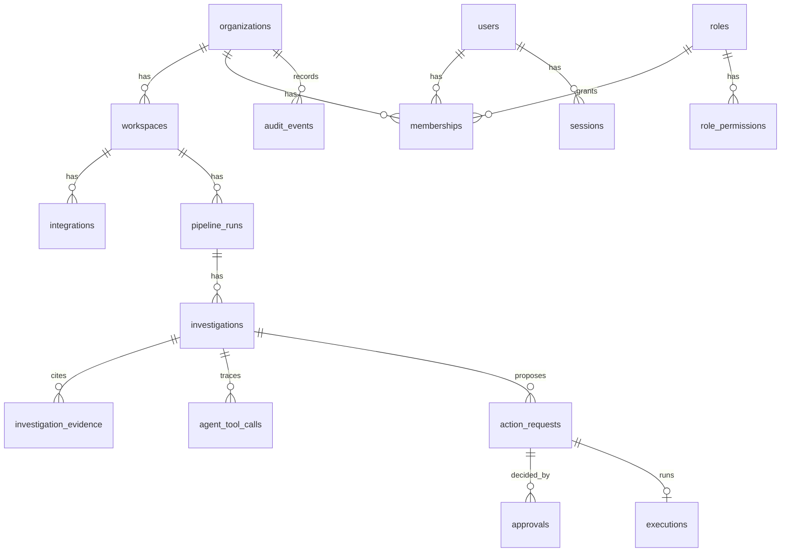

# OpsPilot Data Model (Phase 1 draft, PROPOSED)

All tenant tables carry `org_id`; workspace-scoped tables also carry `workspace_id`.

| Table | Key columns / constraints |
|---|---|
| organizations | id, name |
| workspaces | id, org_id, name |
| users | id, email (unique), name, password_hash (argon2id), disabled |
| roles / role_permissions | role, permission string (`domain:resource:action`) |
| memberships | user_id, org_id, workspace_id (nullable = org-wide), role_id; unique(user, org, workspace) |
| sessions | id_hash, user_id, expires_at, revoked_at, csrf_secret |
| integrations | workspace_id, provider, config (non-secret), secret_ref |
| pipeline_runs | workspace_id, external_id, repo, workflow, status, conclusion, started_at, fetched_at; unique(workspace, provider, external_id) |
| investigations | run_id, status, summary, confidence, model, created_by |
| investigation_evidence | investigation_id, source, ref, excerpt |
| agent_tool_calls | investigation_id, tool, input_hash, output_ref, ts |
| action_requests | type (allowlisted enum), params (JSON, schema-validated), risk, status, requested_by |
| approvals | request_id, decided_by, decision, reason; CHECK decided_by <> requested_by (via service + trigger) |
| executions | request_id, idempotency_key UNIQUE, status, started_at, ended_at, result, error |
| audit_events | org_id, workspace_id, actor_id, action, resource, request_id, payload_hash, ts; append-only |
